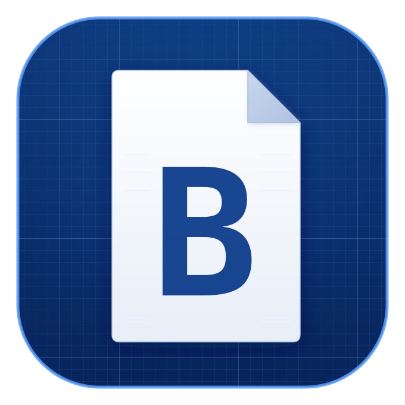
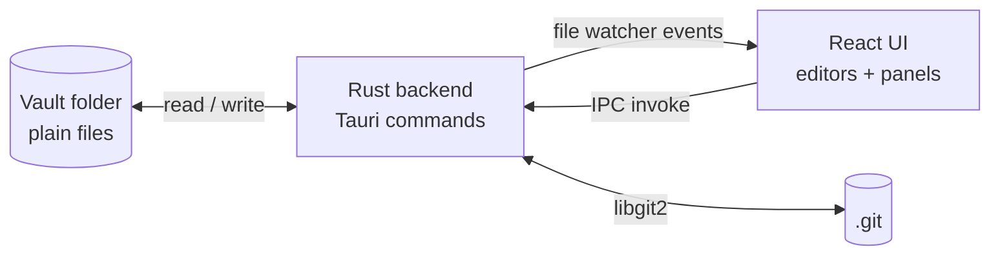

<p align="center">
  
</p>

<h1 align="center">Blueprints</h1>

<p align="center">
  A local-first desktop app for software specs, notes, and diagrams.<br/>
  Plain files in a folder. Git built in. No account, no cloud, no lock-in.
</p>

<p align="center">
  <a href="https://aesbetancourt.github.io/blueprints/"><b>Try the interactive demo</b></a>
</p>

---

## What it is

Blueprints is my personal workspace for thinking about software before and while I build it.
I use it for feature specs, ADRs, architecture docs, runbooks, dev logs, and quick notes.
It keeps all of that next to the diagrams and data files that explain it.

A **vault** is an ordinary folder on disk.
Blueprints shows that folder as a file tree and opens each file in the right editor.
It never stores content in a database, so any other tool can read and change the same files.

## Why I built it

| Need                            | How Blueprints handles it                                                                    |
| ------------------------------- | -------------------------------------------------------------------------------------------- |
| Own my files                    | Everything is plain `.md`, `.mermaid`, `.excalidraw`, `.json`, `.yaml`, `.csv`, or an image. |
| Version history                 | Git status, stage, commit, diff, and log are in the sidebar.                                 |
| One place for docs and diagrams | Markdown, Mermaid, Excalidraw, data files, and images open in tabs side by side.             |
| Start specs fast                | 34 templates for specs, ADRs, RFCs, diagrams, data files, and journals.                      |
| Write for AI coding agents      | The status bar shows an estimated token count for the open document.                         |
| Stay fast and light             | Tauri v2 uses the OS WebView and a Rust backend, not a bundled browser.                      |

Obsidian and Notion can do parts of this.
I wanted a tool that is spec-first, developer-focused, and fully under my control.

## How it works



- The Rust backend owns all file and git access. It rejects paths outside the vault.
- A file watcher pushes disk changes to the UI. Edits from other tools appear at once.
- Settings, tags, and include patterns persist through a Tauri store.
- Tags live in each note's YAML frontmatter, so they move with the file.

For full detail, see [docs/ARCHITECTURE.md](docs/ARCHITECTURE.md) and [docs/TAURI.md](docs/TAURI.md).

## Features

**Editors**

- Markdown: rich (TipTap) or raw mode, with a toggle in the breadcrumb bar
- Slash commands (`/` at line start), tables, task lists, highlights, and find in file
- Wiki links (`[[`), with backlinks and outgoing-links panels
- Variables (`{{today}}`, `{{now}}`, custom values), resolved in templates on create
- Mermaid diagrams with live preview, also inline in Markdown
- Excalidraw canvases
- JSON, YAML, XML, and CSV with a code editor and an interactive graph view
- Image viewer (zoom, pan, rotate, flip) and inline `` images

**Organization**

- File explorer with drag-and-drop, batch select, sort, hide, archive, and color markers
- Frontmatter tags with a vault-wide tag view
- Content and file-name search, with regex
- Inbox folder for quick notes, a scratch pad, and per-file annotations
- Include patterns (a whitelist) that control which files show

## How I use it

1. Open a vault folder. I keep one per project or area, each as its own git repo.
2. Press `⌘⇧N` to capture a quick note. It goes to `inbox/` with a timestamp name.
3. Press `⌘N` to create a real document from a template, such as a Feature Spec or ADR.
4. Link related docs with `[[name]]`. Check the Backlinks panel to see what refers to a doc.
5. Add Mermaid or Excalidraw files next to the spec they explain.
6. Tag documents in the Tags panel to group them across folders.
7. Commit from the Git panel (`⌘⇧G`) when a piece of thinking is done.
8. Give finished specs to a coding agent. The token count shows how much context they use.

Files save automatically when I switch tabs or leave the app. `⌘S` saves at once.

### Shortcuts

| Shortcut      | Action                      |
| ------------- | --------------------------- |
| `⌘P`          | Command palette (open file) |
| `⌘N` / `⌘⇧N`  | New file / quick note       |
| `⌘⇧F`         | Search in files             |
| `⌘F`          | Find in file                |
| `⌘⇧G`         | Git panel                   |
| `⌘J`          | Scratch pad                 |
| `⌘B`          | Toggle sidebar              |
| `⌘W`          | Close tab                   |
| `⌘⇧[` / `⌘⇧]` | Previous / next tab         |
| `⌘,`          | Settings                    |
| `⌘?`          | Shortcut reference          |

The in-app Help panel documents every feature.

## Install and run

### Prerequisites

- [Node.js](https://nodejs.org/) 18 or later
- [pnpm](https://pnpm.io/) 9 or later (the repo rejects npm and yarn)
- [Rust](https://www.rust-lang.org/tools/install) stable toolchain
- [Tauri system dependencies](https://v2.tauri.app/start/prerequisites/) for your OS

### Develop

```bash
pnpm install
pnpm tauri dev   # Desktop app with hot reload
```

`pnpm dev` starts only the frontend in a browser. Tauri APIs are not available there, so vault features do not work.

### Build the app

```bash
pnpm tauri build
```

On macOS, the app is in `src-tauri/target/release/bundle/macos/Blueprints.app`.
Copy it to `/Applications` to use it as a normal app.

## Scripts

| Command            | Description                                |
| ------------------ | ------------------------------------------ |
| `pnpm tauri dev`   | Run the desktop app in development mode    |
| `pnpm tauri build` | Build the distributable app                |
| `pnpm dev`         | Start the Vite dev server (frontend only)  |
| `pnpm build`       | Build the frontend                         |
| `pnpm lint`        | Run ESLint                                 |
| `pnpm typecheck`   | Run the TypeScript compiler with no output |
| `pnpm knip`        | Find unused code and dependencies          |
| `pnpm format`      | Format the code with Prettier              |

A Husky pre-commit hook runs lint-staged on changed files.

## Project structure

```
src/                 React frontend
  components/        Shell, sidebar, panels, modals
  editors/           Markdown, Mermaid, Excalidraw, JSON graph, image viewer
    extensions/      TipTap extensions (slash commands, wiki links, images)
  store/             Zustand stores (workspace, settings, git, annotations)
  services/          Tauri IPC wrappers (vault, git)
  data/              Built-in templates
src-tauri/           Rust backend
  src/commands/      File, git, vault, and system commands
docs/                Architecture and Tauri notes
site/                GitHub Pages showcase (static HTML)
```

## Tech stack

React 19 · TypeScript · Vite · Tailwind CSS · TipTap v3 · Zustand · CodeMirror · Mermaid · Excalidraw · Tauri v2 (Rust)

## Status

This is a personal tool, built for my own workflow.
It is in active use and changes often.
macOS is the main target. Other platforms are not tested.
